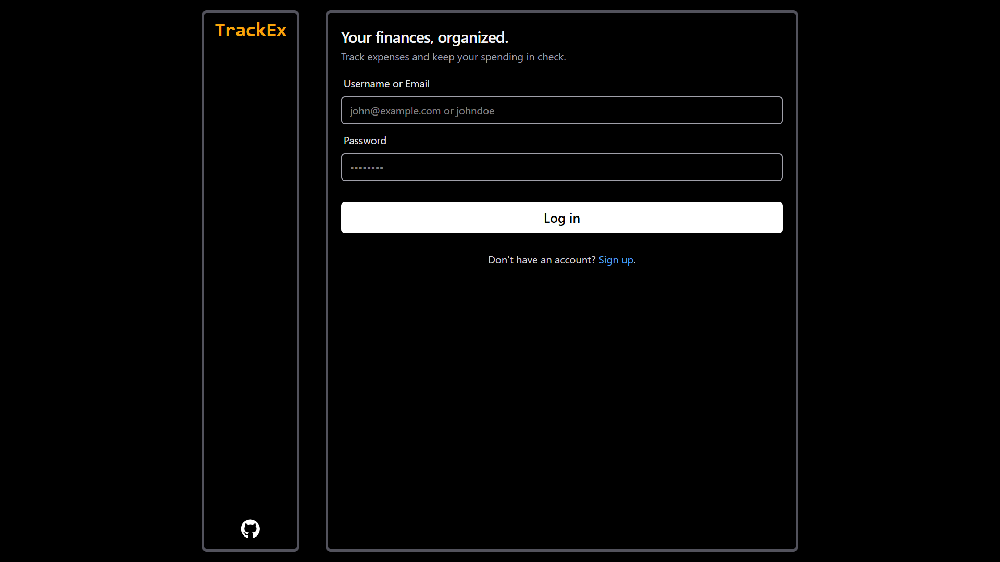
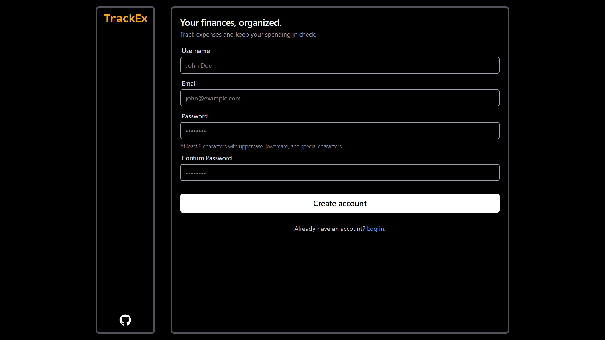
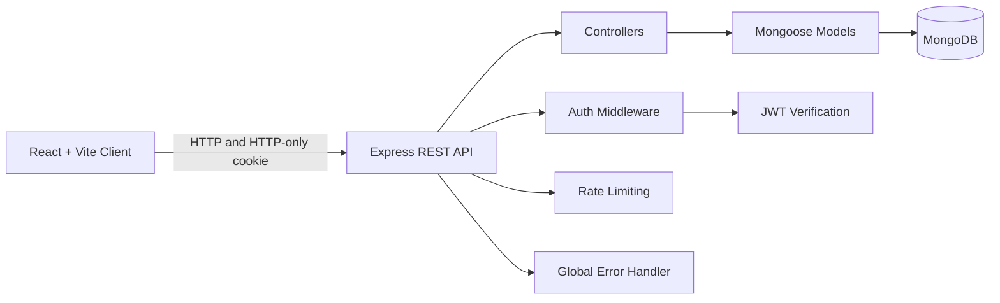

# TrackEx

<p>
  TrackEx is a full-stack personal finance and expense tracking application built to help users record spending, organize expenses by category, and understand their financial activity over time.
</p>

> TrackEx is currently under active development. Authentication and core expense APIs are implemented, while dashboard charts and budget management are being built.

## Current Features

### Implemented

- User registration and login
- Secure logout
- Session validation on application load
- Protected frontend routes
- JWT authentication stored in an HTTP-only cookie
- Password hashing with bcrypt
- Expense creation, retrieval, update, and deletion
- Expenses scoped to the authenticated user
- Fixed expense categories
- Paginated expense lists
- Daily and monthly expense filtering
- Monthly spending total
- Currency-safe storage using integer paisa values
- Centralized API error handling
- Request validation and login/register rate limiting

### Planned

- Monthly and category budgets
- Budget usage and exceeded-budget indicators
- Dashboard summary
- Spending-by-category chart
- Spending-over-time chart
- Recent expense list
- Advanced expense filtering
- Account settings and password updates
- Account deletion

## Screenshots

| Authentication | Expense Dashboard |
|---|---|
| <br> |  |

Additional mobile and expense layouts are available in [UI_Layout](UI_Layout/).

## Tech Stack

### Frontend

- React 19
- React Router
- Axios
- Tailwind CSS 4
- Vite
- Context API for authentication state
- Vitest and Testing Library

### Backend

- Node.js
- Express 5
- MongoDB
- Mongoose
- JSON Web Tokens
- bcrypt
- express-validator
- cookie-parser
- express-rate-limit

### Planned UI

- Shadcn-style reusable components
- Recharts or Chart.js for dashboard visualizations

## Architecture

TrackEx uses a client-server architecture with a React frontend and an Express REST API. MongoDB stores users, expenses, and future budget records.



### Backend request flow

```text
Client
  -> Route
  -> Validators
  -> Authentication middleware
  -> Controller
  -> Mongoose model
  -> MongoDB
  -> JSON response
  -> Central error handler when needed
```

### Application structure

```text
ZTrackEx/
|-- backend/
|   |-- src/
|   |   |-- config/        # Database, cookies, and JWT configuration
|   |   |-- constants/     # Shared expense category constants
|   |   |-- controllers/   # Authentication and expense business logic
|   |   |-- middleware/    # Authentication, validation, rate limiting, errors
|   |   |-- models/        # Mongoose user, expense, and budget schemas
|   |   |-- routes/        # REST route definitions
|   |   `-- app.js         # Express middleware and route setup
|   |-- tests/             # Unit and integration tests
|   |-- server.js          # Server entry point
|   `-- package.json
|-- frontend/
|   |-- src/
|   |   |-- component/     # Shared UI components
|   |   |-- context/       # Authentication context
|   |   |-- hooks/         # Application hooks
|   |   |-- pages/         # Login, register, home, and expenses pages
|   |   |-- services/      # Axios API client and auth requests
|   |   `-- utils/         # Protected routes and shared utilities
|   |-- tests/
|   `-- package.json
|-- Project-Design-Architecture/
`-- UI_Layout/
```

## Data Model

### User

| Field | Type | Behavior |
|---|---|---|
| `username` | String | Required, unique, 3-20 characters |
| `email` | String | Required, unique, normalized to lowercase |
| `password` | String | Stored as a bcrypt hash |

### Expense

| Field | Type | Behavior |
|---|---|---|
| `title` | String | Required expense title |
| `amount` | Number | Stored as an integer in paisa |
| `category` | Enum | One of the fixed category values |
| `date` | Date | Date when the expense occurred |
| `user` | ObjectId | References the owning user |

The expense category values are:

```text
Food, Rent, Travel, Shopping, Utilities, Entertainment, Health, Others
```

Amounts are converted from rupees to paisa before database writes and back to rupees in API responses. This avoids floating-point precision issues in financial calculations.

### Budget

A budget schema is present and is designed to support both a monthly total and category-specific limits. Its API routes are still under development.

```text
limit     # Budget limit stored in the database
category  # Null for a monthly budget; category name for category budgets
user      # References the owning user
```

## Authentication and Security

- Passwords are never stored as plain text.
- JWTs are signed with `JWT_SECRET` and expire after seven days.
- Tokens are stored in an HTTP-only cookie named `TrackEx_token`.
- Cookies are secure in production and use `SameSite=None`; local development uses `SameSite=Strict`.
- Protected API routes verify both the JWT and that the user still exists.
- Expense queries include the authenticated user's ID.
- Login and registration endpoints have independent rate limits.
- The global API is also rate limited.
- Express is configured to trust proxy hops when deployed behind proxy infrastructure.
- CORS requires credentials and uses separate development and production origins.
- Validation protects inputs before controllers run.

## API Overview

All routes are mounted below `/api`.

### Authentication

| Method | Endpoint | Description |
|---|---|---|
| `POST` | `/api/auth/register` | Create an account and establish a session |
| `POST` | `/api/auth/login` | Log in with a username or email |
| `POST` | `/api/auth/logout` | Clear the authentication cookie |
| `GET` | `/api/auth/me` | Return the current authenticated user |

### Expenses

| Method | Endpoint | Description |
|---|---|---|
| `GET` | `/api/expenses` | Get paginated expenses with optional date filtering |
| `GET` | `/api/expenses/month` | Get expenses from the current month |
| `GET` | `/api/expenses/monthlyTotal` | Get the current month's spending total |
| `GET` | `/api/expenses/:id` | Get one expense |
| `POST` | `/api/expenses` | Create an expense |
| `PATCH` | `/api/expenses/:id` | Update an expense |
| `DELETE` | `/api/expenses/:id` | Delete an expense |

Example expense list request:

```http
GET /api/expenses?page=1&limit=20&date=2026-10-24
```

Expenses are sorted by date descending, then by ID descending. Date filtering uses a start-of-day to start-of-next-day UTC range.

### Planned API Groups

| Base route | Purpose |
|---|---|
| `/api/budgets` | Monthly and category budget management |
| `/api/dashboards` | Aggregated dashboard data |
| `/api/categories` | Fixed expense category lookup |
| `/api/users` | Username, password, and account management |

## Frontend Routes

| Route | Access | Status |
|---|---|---|
| `/login` | Public | Implemented |
| `/register` | Public | Implemented |
| `/` | Protected | Basic dashboard is implemented |
| `/expenses` | Protected | Placeholder currently |
| `/serverError` | Public | Implemented |

Protected routes verify the user's session through `/api/auth/me` before rendering.

## Error and Loading Handling

The backend uses centralized Express error middleware. API responses use predictable message and data fields, and authentication failures return suitable `401` responses.

The frontend distinguishes loading, network, authentication, authorization, and server error states so it can guide users to the correct action instead of exposing raw errors.

## Getting Started

### Prerequisites

- Node.js 20 or newer
- npm
- MongoDB local instance or MongoDB Atlas

### 1. Clone the repository

```bash
git clone https://github.com/KSAdhikari008/ZTrackEx.git
cd ZTrackEx
```

### 2. Configure the backend

```bash
cd backend
npm install
cp .env.example .env
```

Set the backend environment variables:

```env
PORT=5000
MONGODB_URI=mongodb://localhost:27017/trackex
JWT_SECRET=replace-with-a-long-random-secret
NODE_ENV=development
ORIGIN_URL=http://localhost:5173
ORIGIN_URL_PROD=https://your-production-domain.example
```

Start the backend:

```bash
npm run dev
```

The API will run on `http://localhost:5000` by default.

### 3. Configure the frontend

Open a second terminal:

```bash
cd frontend
npm install
cp .env.example .env
```

Set the frontend environment variables:

```env
VITE_API_URL=http://localhost:5000/api
VITE_API_URL_PROD=https://your-production-api.example/api
VITE_ENV=development
```

Start the frontend:

```bash
npm run dev
```

Vite will print the local application URL, normally `http://localhost:5173`.

## Development Scripts

### Backend

```bash
npm run dev      # Start with nodemon
npm start        # Start normally
npm test         # Run Vitest tests
```

### Frontend

```bash
npm run dev      # Start the Vite development server
npm run build    # Create a production build
npm run lint     # Run ESLint
npm test         # Run Vitest tests
npm run preview  # Preview the production build
```

## Testing

The project uses Vitest for backend and frontend tests.

Backend tests cover areas such as authentication middleware, request validators, and expense controllers. Frontend tests cover user interface behavior such as navigation components.

Run both suites from their respective directories:

```bash
npm test
```

## Design Decisions

- Context API is used for authentication state because it fits the application's current scope.
- Axios is centralized in one API client with credentials enabled for cookie-based authentication.
- Express routes remain thin and delegate request logic to controllers.
- Mongoose schemas define the current database shape and validation rules.
- Expense records belong to a user and every expense query is user-scoped.
- Expense amounts are stored in paisa to prevent decimal precision problems.
- UTC month boundaries are used for consistent monthly calculations.
- HTTP-only cookies are preferred over browser local storage for JWT storage.
- Fixed categories are currently returned from backend constants so the frontend and API share one source of truth.

## Project Roadmap

- [x] Define project features and architecture
- [x] Create MongoDB models
- [x] Implement authentication
- [x] Implement HTTP-only JWT cookies
- [x] Implement expense CRUD
- [x] Add expense pagination and date filtering
- [x] Add monthly totals
- [ ] Build the expense list interface
- [ ] Build add and edit expense forms
- [ ] Implement monthly budgets
- [ ] Implement category budgets
- [ ] Add dashboard aggregation APIs
- [ ] Add spending charts
- [ ] Add account management
- [ ] Improve automated test coverage
- [ ] Deploy frontend and backend

## Contributing

TrackEx is a learning-focused MERN project, but contributions are welcome.

1. Create a feature branch.
2. Make a focused, documented change.
3. Add or update tests for behavior changes.
4. Run the relevant frontend or backend test and lint commands.
5. Open a pull request with the implementation and verification details.

## License

License information has not been added yet.