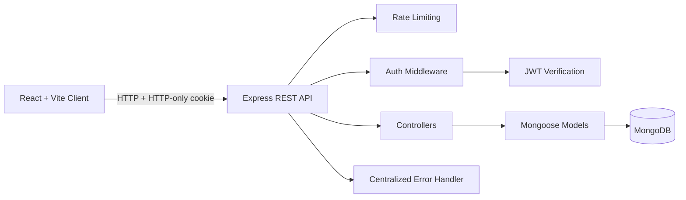

# TrackEx — Personal Expense Tracker

TrackEx is a full-stack personal finance application that helps users record expenses, organize spending by category, and understand their financial activity over time.

**[Live Demo](https://z-track-ex.vercel.app)** · **[GitHub Repository](https://github.com/KSAdhikari008/ZTrackEx)**

> **Project status:** Actively under development. Authentication and the core expense APIs are implemented. The dashboard shows a live monthly total, but its other summary cards still use placeholder values. Budget management and the expense interface are not finished yet.

## Screenshots

| Login | Registration | Dashboard |
|:---:|:---:|:---:|
|  |  |  |

Additional desktop and mobile layouts are available in [`UI_Layout`](UI_Layout/).

## Features

### Implemented

- User registration and login (by username or email)
- Secure logout and session validation on application load
- Protected frontend routes
- JWT authentication stored in an HTTP-only cookie
- Password hashing with bcrypt
- Expense create, read, update, and delete APIs, scoped to the authenticated user
- Fixed expense categories
- Paginated expense lists with daily and monthly filtering
- Monthly spending total
- Money stored as integer paise to avoid floating-point precision issues
- Centralized API error handling and request validation
- Independent rate limits on login and registration, plus global API rate limiting
- Account deletion

### In progress

- The dashboard displays a live monthly total; the other summary cards use placeholder values.
- A budget schema exists, but budget API routes and functionality are not implemented.
- Username and password update handlers are unfinished.

### Planned

- Expense list and add/edit forms
- Monthly and category budgets (API and UI), with usage and exceeded-budget indicators
- Dashboard aggregation APIs and live data for the remaining cards
- Spending-by-category and spending-over-time charts
- Recent expense activity and advanced filtering
- Account settings, including username and password updates

## Tech Stack

| Frontend | Backend |
|---|---|
| React 19 | Node.js |
| React Router | Express 5 |
| Tailwind CSS 4 | MongoDB |
| Axios | Mongoose |
| Vite | JSON Web Tokens |
| Context API | bcrypt |
| Vitest | express-validator |
| React Testing Library | cookie-parser |
| | express-rate-limit |

**Planned UI:** Shadcn-style reusable components and Recharts or Chart.js for dashboard visualizations.

## Architecture

TrackEx uses a client-server architecture. A React application communicates with an Express REST API, and MongoDB stores users, expenses, and future budget records.



### Backend request lifecycle

```text
Client Request
     |
     v
Express Router
     |
     v
Request Validators
     |
     v
Authentication Middleware (protected routes)
     |
     v
Controller
     |
     v
Mongoose Model --> MongoDB
     |
     v
JSON Response
```

Errors at any step are forwarded to the centralized Express error-handling middleware.

### Project structure

```text
ZTrackEx/
|-- backend/
|   |-- src/
|   |   |-- config/        # Database, cookie, and JWT configuration
|   |   |-- constants/     # Shared expense category constants
|   |   |-- controllers/   # Authentication and expense business logic
|   |   |-- middleware/    # Authentication, validation, rate limiting, errors
|   |   |-- models/        # Mongoose user, expense, and budget schemas
|   |   |-- routes/        # REST route definitions
|   |   `-- app.js         # Express middleware and route setup
|   |-- tests/             # Unit and integration tests
|   |-- server.js          # Server entry point
|   `-- package.json
|-- frontend/
|   |-- src/
|   |   |-- component/     # Shared UI components
|   |   |-- context/       # Authentication context
|   |   |-- hooks/         # Application hooks
|   |   |-- pages/         # Login, register, home, and expenses pages
|   |   |-- services/      # Axios API client and auth requests
|   |   `-- utils/         # Protected routes and shared utilities
|   |-- tests/
|   `-- package.json
|-- Project-Design-Architecture/
|-- UI_Layout/
`-- Readme.md
```

## Data Model

### User

| Field | Type | Description |
|---|---|---|
| `username` | String | Required, unique, 3–20 characters |
| `email` | String | Required, unique, normalized to lowercase |
| `password` | String | Stored as a bcrypt hash |

### Expense

| Field | Type | Description |
|---|---|---|
| `title` | String | Required expense title |
| `amount` | Number | Stored as an integer in paise |
| `category` | Enum | One of the fixed category values |
| `date` | Date | Date when the expense occurred |
| `user` | ObjectId | Reference to the owning user |

**Supported categories:** `Food`, `Rent`, `Travel`, `Shopping`, `Utilities`, `Entertainment`, `Health`, `Others`

### Budget

A budget schema is present to support both a monthly total and category-specific limits. Budget API routes and functionality are not implemented yet.

| Field | Description |
|---|---|
| `limit` | Budget limit |
| `category` | Null for a monthly budget; category name for a category budget |
| `user` | Reference to the owning user |

### Monetary precision

Expense amounts are converted from rupees to integer paise before database writes and converted back to rupees in API responses. This avoids floating-point precision issues in financial calculations.

## Authentication and Security

- Passwords are hashed with bcrypt and never stored as plain text.
- JWTs are signed with `JWT_SECRET` and expire after seven days.
- Tokens are stored in an HTTP-only cookie named `TrackEx_token`, out of reach of browser JavaScript.
- Cookies are `Secure` in production and use `SameSite=None`; local development uses `SameSite=Strict`.
- Protected API routes verify the JWT and confirm that the user still exists.
- Every expense query is scoped to the authenticated user's ID.
- Login and registration have independent IP-based rate limits, and the global API is rate limited as well.
- Express is configured to trust proxy hops when deployed behind proxy infrastructure.
- CORS requires credentials and uses separate development and production origins.
- Request validation runs before controllers.

## API Documentation

All routes are mounted under `/api`.

### Authentication

| Method | Endpoint | Description |
|---|---|---|
| `POST` | `/api/auth/register` | Create an account and establish a session |
| `POST` | `/api/auth/login` | Log in with a username or email |
| `POST` | `/api/auth/logout` | Clear the authentication cookie |
| `GET` | `/api/auth/me` | Return the current authenticated user |

### Expenses

| Method | Endpoint | Description |
|---|---|---|
| `GET` | `/api/expenses` | Get paginated expenses with optional date filtering |
| `GET` | `/api/expenses/month` | Get the current month's expenses |
| `GET` | `/api/expenses/monthlyTotal` | Get the current month's spending total |
| `GET` | `/api/expenses/:id` | Get one expense |
| `POST` | `/api/expenses` | Create an expense |
| `PATCH` | `/api/expenses/:id` | Update an expense |
| `DELETE` | `/api/expenses/:id` | Delete an expense |

### Example request

```http
GET /api/expenses?page=1&limit=20&date=2026-10-24
```

Expenses are sorted by date descending, then by ID descending. Date filtering uses a start-of-day to start-of-next-day UTC range.

### Example response

Response shape for `GET /api/expenses?page=1&limit=20` (`amount` is returned in rupees):

```json
{
  "message": "Expenses retrieved successfully",
  "data": {
    "totalExpenses": 1,
    "expenses": [
      {
        "_id": "example-id",
        "title": "Groceries",
        "amount": 450,
        "category": "Food",
        "date": "2026-11-25T00:00:00.000Z"
      }
    ]
  }
}
```

### Other API status

| Base route | Purpose | Status |
|---|---|---|
| `/api/budgets` | Budget management | Not implemented; schema exists |
| `/api/dashboards` | Dashboard aggregations | Not implemented |
| `/api/categories` | Category lookup | Not implemented; categories live in backend constants |
| `/api/users` | Account management | Account deletion implemented; username and password updates unfinished |

## Frontend Routes

| Route | Access | Status |
|---|---|---|
| `/login` | Public | Implemented |
| `/register` | Public | Implemented |
| `/` | Protected | Partial: monthly total is live; other cards use placeholder values |
| `/expenses` | Protected | Placeholder |
| `/serverError` | Public | Implemented |

Protected routes verify the user's session through `/api/auth/me` before rendering.

## Error and Loading Handling

The centralized error handler returns `message` and `errors` fields, with a stack trace in development. Successful endpoints may include a `data` field; response shapes vary by endpoint. Authentication failures return suitable `401` responses.

The frontend distinguishes loading, network, authentication, authorization, and server error states, so users get appropriate guidance instead of raw server errors.

## Getting Started

### Prerequisites

- Node.js 20 or newer
- npm
- A local MongoDB instance or MongoDB Atlas

### 1. Clone the repository

```bash
git clone https://github.com/KSAdhikari008/ZTrackEx.git
cd ZTrackEx
```

### 2. Configure and start the backend

```bash
cd backend
npm install
cp .env.example .env
```

Set the backend environment variables:

```env
PORT=5000
MONGODB_URI=mongodb://localhost:27017/trackex
JWT_SECRET=replace-with-a-long-random-secret
NODE_ENV=development
ORIGIN_URL=http://localhost:5173
ORIGIN_URL_PROD=https://your-production-domain.example
```

```bash
npm run dev
```

The API runs on `http://localhost:5000` by default.

### 3. Configure and start the frontend

In a second terminal:

```bash
cd frontend
npm install
cp .env.example .env
```

Set the frontend environment variables:

```env
VITE_API_URL=http://localhost:5000/api
VITE_API_URL_PROD=https://your-production-api.example/api
VITE_ENV=development
```

```bash
npm run dev
```

Vite prints the local application URL, normally `http://localhost:5173`.

## Development Scripts

### Backend

| Command | Description |
|---|---|
| `npm run dev` | Start the development server with Nodemon |
| `npm start` | Start the production server |
| `npm test` | Run backend tests |

### Frontend

| Command | Description |
|---|---|
| `npm run dev` | Start the Vite development server |
| `npm run build` | Create a production build |
| `npm run lint` | Run ESLint |
| `npm test` | Run frontend tests |
| `npm run preview` | Preview the production build |

## Testing

TrackEx uses Vitest for both frontend and backend tests.

- **Backend tests** cover authentication middleware, request validators, and expense controllers.
- **Frontend tests** cover UI behavior such as navigation components.

Run the tests from the `backend` or `frontend` directory:

```bash
npm test
```

## Engineering Decisions

- **HTTP-only cookies:** JWTs are kept out of JavaScript-accessible browser storage.
- **Integer money storage:** Amounts are stored in paise to avoid floating-point errors.
- **User-scoped queries:** Every expense query is restricted to its authenticated owner.
- **UTC date boundaries:** Day and month calculations are consistent regardless of server locale.
- **Separation of concerns:** Routes delegate business logic to controllers.
- **Context API:** Used for authentication state because it fits the application's current scope.
- **Centralized Axios client:** Keeps API configuration and cookie credentials consistent.
- **Shared category constants:** Backend constants are the single source of truth for expense categories.

## Roadmap

- [x] Define project features and architecture
- [x] Create MongoDB models
- [x] Implement authentication with HTTP-only JWT cookies
- [x] Implement expense CRUD
- [x] Add expense pagination and date filtering
- [x] Add monthly totals
- [x] Deploy frontend and backend
- [x] Implement account deletion
- [ ] Build the expense list interface
- [ ] Build add and edit expense forms
- [ ] Implement monthly budgets
- [ ] Implement category budgets
- [ ] Implement dashboard aggregation APIs and connect the remaining cards to live data
- [ ] Add spending charts
- [ ] Implement username and password updates
- [ ] Improve automated test coverage

## Contributing

TrackEx is a learning-focused MERN project, and contributions are welcome.

1. Create a feature branch.
2. Make a focused, documented change.
3. Add or update tests for behavior changes.
4. Run the relevant test and lint commands.
5. Open a pull request describing the changes and how you verified them.

## License

License information has not been added yet.